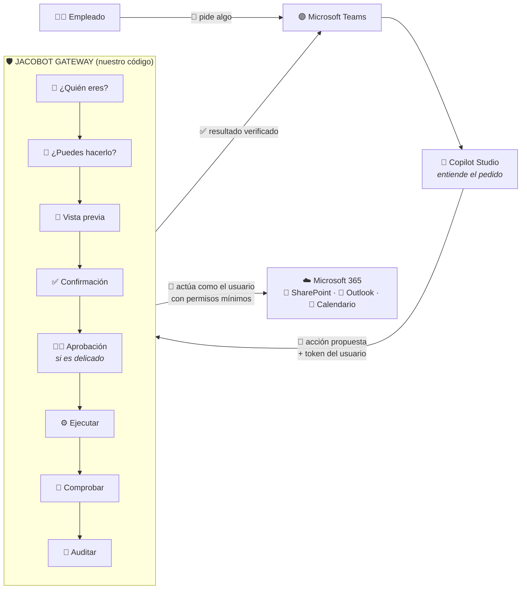
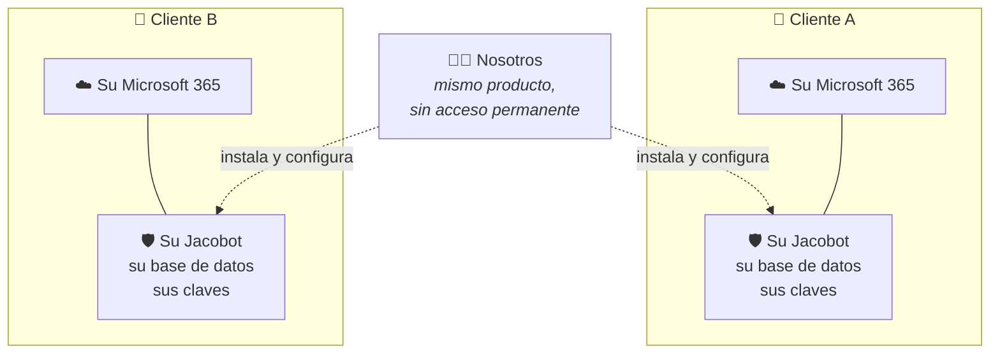

<div align="center">

```
     ╔══════════════════════════════════════════════╗
     ║                                              ║
     ║          J A C O B O T    2 . 0              ║
     ║                                              ║
     ║   Tu compañero de trabajo en Microsoft 365   ║
     ║                                              ║
     ╚══════════════════════════════════════════════╝
```

# 🤖

**Agente empresarial de IA que trabaja dentro de Microsoft 365: le hablas en Teams y él organiza
documentos, proyectos y tareas en SharePoint, de forma segura y auditada.**


</div>

---

## 📖 Índice

| | Documento | Para quién |
|---|---|---|
| 🤖 | [¿Qué es Jacobot?](#-qué-es-jacobot) (aquí abajo) | Todos |
| ⚙️ | [Cómo funciona por dentro](docs/01-como-funciona.md) | Técnicos y curiosos |
| 🛡️ | [Seguridad](docs/02-seguridad.md) | Clientes, TI, auditores |
| 🧰 | [Stack tecnológico](docs/03-stack.md) | Desarrolladores |
| 🗺️ | [Roadmap y visión](docs/04-roadmap.md) | Todos |
| 📚 | [Glosario](docs/05-glosario.md) | Quien no sea técnico |
| 📋 | [Ficha técnica](docs/06-ficha-tecnica.md) | TI, compras, evaluadores |

> ℹ️ Este repositorio **solo contiene documentación**. El código fuente vive en un repositorio
> privado aparte.

---

## 🤖 ¿Qué es Jacobot?

Jacobot es un **asistente de IA para empresas** que se instala en el Microsoft 365 de cada
cliente. Los empleados le piden cosas **en lenguaje normal, desde Microsoft Teams**, y Jacobot
las hace por ellos: crea proyectos, archiva documentos, encuentra archivos y, en las próximas
fases, agenda reuniones, pone recordatorios y responde con el conocimiento de la empresa.

La diferencia con un chatbot cualquiera: **la IA nunca toca nada directamente.** Solo *propone*
acciones; una pieza de software propia (el **Gateway**) verifica quién eres, qué puedes hacer,
te muestra una vista previa, pide tu confirmación (y la aprobación de otra persona si es algo
delicado), ejecuta, comprueba el resultado y lo deja registrado.

### 💬 Así se ve en Teams

> 💬 **Teams · Jacobot**
>
> 👩 **Ana:** Jacobot, crea un proyecto llamado Migración SAP
>
> 🤖 **Jacobot:** 📋 **Vista previa**
>
> | | |
> |---|---|
> | Operación | Crear proyecto |
> | Proyecto | Migración SAP |
> | Ubicación | Proyectos |
> | Carpetas | 📁 Cotizaciones · 📁 Specs técnicas · 📁 Prototipos · 📁 Otros |
>
> ¿Confirmas? &nbsp; `✅ Confirmar` &nbsp; `❌ Cancelar`
>
> 👩 **Ana:** ✅ Confirmar
>
> 🤖 **Jacobot:** ✅ Proyecto Migración SAP creado correctamente. 🔗 *Abrir en SharePoint*

Otros ejemplos:

| 🗣️ Lo que dices | 🤖 Lo que hace Jacobot |
|---|---|
| *"Archiva esta cotización en Migración SAP"* | Sugiere la categoría (📁 Cotizaciones) por el nombre del archivo, te muestra el destino y lo mueve cuando confirmas |
| *"Encuentra el último contrato firmado con ABC"* | Busca **solo** en lo que tú tienes permiso de ver y te da el más reciente |
| *"Renombra este archivo a Cotización final"* | Conserva la extensión (`.pdf`) y no toca el archivo si alguien lo cambió mientras tanto |
| *"Agenda una reunión con compras el jueves"* ⏳ | Mira disponibilidad, propone horario y solo envía la invitación cuando confirmas |
| *"Recuérdame revisar el contrato el lunes"* ⏳ | Crea el recordatorio en tu To Do / calendario |
| *"¿Cuál es el proceso de compras?"* ⏳ | Responde con las fuentes que la empresa aprobó |

⏳ = en el roadmap ([ver visión completa](docs/04-roadmap.md))

---

## 🗺️ Cómo funciona (en un dibujo)



**La regla de oro:** 🧠 la IA *propone* → 🛡️ el Gateway *decide* → ☁️ Microsoft 365 *ejecuta*.

---

## 🧩 ¿Qué puede hacer hoy?

| Capacidad | Estado |
|---|---|
| 📁 Crear proyectos con su estructura de carpetas | ✅ Construido y probado |
| 🗂️ Archivar documentos (con categoría sugerida) | ✅ Construido y probado |
| 🔀 Mover documentos entre proyectos | ✅ Construido y probado |
| ✏️ Renombrar documentos | ✅ Construido y probado |
| 🔍 Buscar documentos y proyectos | ✅ Construido y probado |
| 📒 Registro documental en SharePoint | ✅ Construido y probado |
| 🧑‍⚖️ Aprobaciones con segregación de funciones | ✅ Construido y probado |
| ☁️ Conexión real con Microsoft 365 | 🟡 Programada y probada contra una simulación · **falta tenant real** |
| 💬 Teams + Copilot Studio | ⏳ Fase 4 |
| 📅 Reuniones · ⏰ Recordatorios · 📧 Correo | ⏳ Fase 5 |
| 🧠 Conocimiento de la empresa | ⏳ Fase 4–5 |
| 🖥️ Portal de administración | ⏳ Fase 6 |

> ⚠️ **Honestidad ante todo:** todas las pruebas actuales corren contra entornos **simulados**.
> Nada se ha ejecutado todavía contra un Microsoft 365 real.

---

## 🛡️ Seguridad en 30 segundos

| | Control | Qué significa |
|---|---|---|
| 🔐 | Identidad verificada | Solo se aceptan tokens válidos de Microsoft Entra ID |
| 📜 | Catálogo cerrado | La IA solo puede pedir acciones de una lista fija |
| 👀 | Vista previa + confirmación | Nada se ejecuta sin que veas antes qué va a pasar |
| 🧑‍⚖️ | Aprobación por otra persona | Para documentos confidenciales o acciones de riesgo |
| 🔑 | Permisos mínimos | Solo en los sitios que el cliente autoriza (`Sites.Selected`) |
| 📒 | Auditoría encadenada | Editar o insertar eventos se detecta ([límites conocidos](docs/06-ficha-tecnica.md)) |
| 🧪 | Revisión adversarial | Cada fase la revisa un modelo de IA que intenta romperla (no es un pentest externo) |

Más detalle en [🛡️ Seguridad](docs/02-seguridad.md).

---

## 🧰 Stack en una línea

🐍 **Python 3.12** · ⚡ **FastAPI** · 🧾 **Pydantic** · 🗄️ **SQLAlchemy + PostgreSQL** · 🔁 **Alembic** ·
🔐 **MSAL + Entra ID** · ☁️ **Microsoft Graph** · 🧪 **pytest · ruff · mypy** · 🐳 **Docker** ·
🧠 **Copilot Studio** · 💬 **Teams**

Detalle con versiones y razones en [🧰 Stack](docs/03-stack.md).

---

## 🏢 Modelo de negocio



- 🧱 **Una instalación por cliente**: sin bases de datos compartidas ni documentos de distintos
  clientes mezclados.
- 🔁 **Mismo código para todos**: cada cliente se configura, no se reprograma.
- 🚪 **Salida limpia (offboarding)**: se retiran los permisos y se borran los recursos del cliente.
- 💰 Los costos (Azure, Copilot Studio, licencias) se calcularán con precios oficiales antes de
  cada fase que los implique.

---

## 📍 Estado del proyecto

| Fase | | Avance | Estado |
|---|---|---|---|
| 0 | 📐 Diseño y arquitectura | `██████████` | ✅ |
| 1 | 🧱 Base del sistema | `██████████` | ✅ |
| 2 | 🗂️ Gestión documental | `██████████` | ✅ |
| 3 | ☁️ Conexión con Microsoft 365 | `████████░░` | 🟡 falta probarla en un tenant real |
| 4 | 💬 Teams + Copilot Studio | `░░░░░░░░░░` | ⏳ |
| 5 | 📅 Outlook, calendario, módulos | `░░░░░░░░░░` | ⏳ |
| 6 | 🖥️ Portal de administración | `░░░░░░░░░░` | ⏳ |
| 7 | 🚀 Infraestructura en Azure | `░░░░░░░░░░` | ⏳ |
| 8 | 🧪 Auditoría final y piloto | `░░░░░░░░░░` | ⏳ |

📊 **205 pruebas distintas pasando**, en SQLite y en PostgreSQL (305 ejecuciones en cada una: 100 se
repiten sobre el adaptador HTTP) · 🔍 **4 revisiones de seguridad hechas por un modelo de IA**; los
hallazgos están corregidos, pero los de la última no se han vuelto a auditar. No son un pentest
externo. Ver la [ficha técnica](docs/06-ficha-tecnica.md).

---

<div align="center">

🤖 *Jacobot propone · tú decides · todo queda registrado*

</div>
