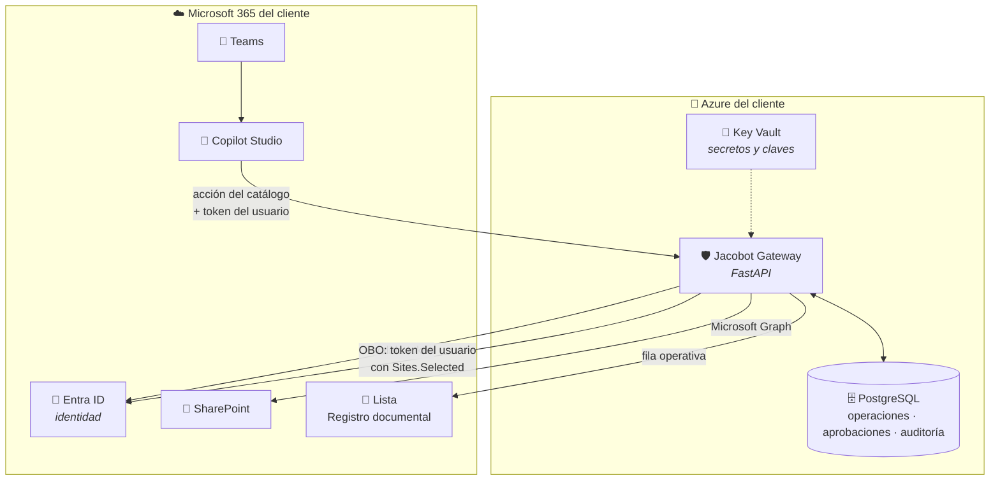
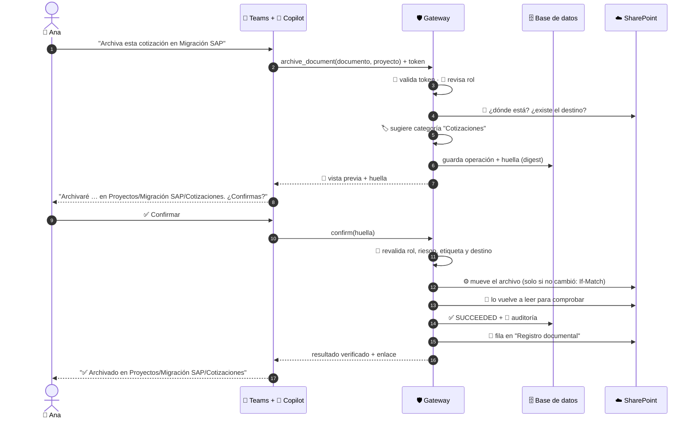
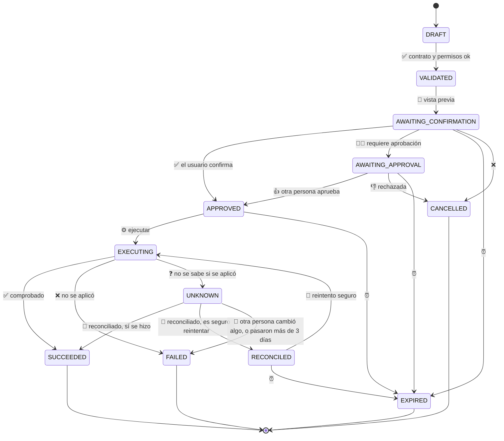
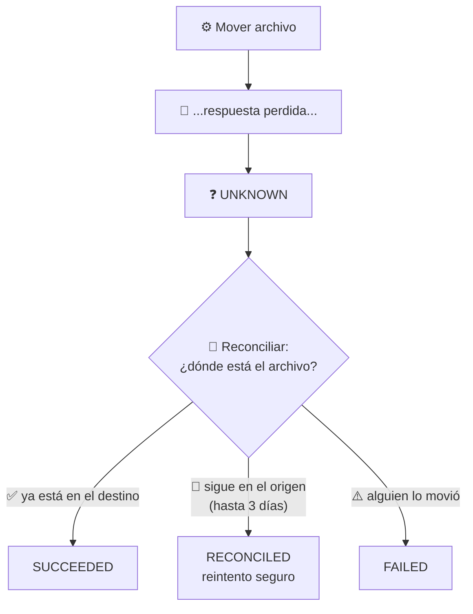
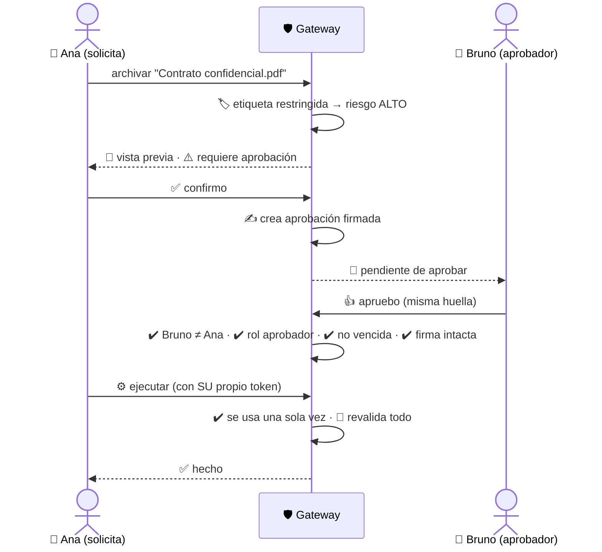

# ⚙️ Cómo funciona Jacobot por dentro

[⬅️ Volver al inicio](../README.md)

---

## 🧱 Las piezas



| Pieza | Qué hace | Analogía 🧑‍🍳 |
|---|---|---|
| 💬 **Teams** | Donde el empleado escribe | El mostrador |
| 🧠 **Copilot Studio** | Entiende el pedido y elige la herramienta | El mesero que toma la orden |
| 🛡️ **Gateway** | Verifica, pide confirmación, ejecuta y audita | El jefe de cocina que revisa cada orden |
| 🔐 **Entra ID** | Confirma quién es cada persona | El guardia de la puerta |
| 📂 **SharePoint** | Donde viven los documentos | La despensa |
| 🗄️ **PostgreSQL** | Memoria oficial de operaciones y aprobaciones | El libro de órdenes |
| 📒 **Registro documental** | Lista que la gente puede leer en SharePoint | La pizarra a la vista |

---

## 🔄 La vida de una solicitud



### 🔑 La "huella" (digest)

Cuando Jacobot prepara una operación, calcula una **huella criptográfica** de *exactamente*
lo que se va a hacer: qué archivo, qué destino, quién lo pide y con qué nivel de riesgo. La
confirmación y la aprobación quedan atadas a esa huella. Si alguien cambia algo después, aunque
sea directamente en la base de datos, la huella deja de coincidir y Jacobot se niega a ejecutar. 🚫

---

## 🚦 La máquina de estados

Cada operación pasa por estados explícitos. No hay atajos:



### ❓ ¿Por qué existe "UNKNOWN"?

Internet falla. A veces Microsoft **sí** movió el archivo, pero la respuesta se perdió por el
camino. Un sistema ingenuo reintentaría y crearía duplicados, o diría "falló" cuando en realidad
funcionó. Jacobot marca esos casos como **UNKNOWN** y, antes de reintentar, **reconcilia**: mira
en SharePoint qué pasó de verdad.



---

## 🧑‍⚖️ Aprobaciones



Las reglas:
- 🚫 **Nadie se aprueba a sí mismo.**
- ✍️ **Cada aprobación va firmada**: si alguien la edita en la base de datos, se detecta.
- ⏰ **Vence** pasado un tiempo.
- 1️⃣ **Se usa una sola vez.**
- 🔑 **La ejecución usa el token de quien pidió**, nunca el del aprobador.

---

## 🗂️ La estructura de documentos

```
📂 Biblioteca de documentos (sitio autorizado)
├── 📥 Bandeja de entrada          ← archivos por archivar
└── 📁 Proyectos
    ├── 📁 Migración SAP
    │   ├── 📁 Cotizaciones        ← "Cotizacion_ABC_2026.pdf" va aquí
    │   ├── 📁 Specs técnicas
    │   ├── 📁 Prototipos
    │   └── 📁 Otros
    └── 📁 Implementación ERP
        └── ...
```

🔒 Jacobot **solo** puede tocar la 📥 Bandeja de entrada y las carpetas
`Proyectos/{proyecto}/{categoría}`. Lo comprueba subiendo por los **identificadores** de las
carpetas, no comparando rutas de texto: una ruta cambia si alguien renombra una carpeta, y el
identificador no. Fuera de esa zona, todo responde lo mismo: "no encontrado".

### 🏷️ Categoría sugerida

| Archivo | Sugerencia |
|---|---|
| `Cotizacion_ABC_2026.pdf` | 📁 Cotizaciones |
| `Presupuesto final.xlsx` | 📁 Cotizaciones |
| `Especificaciones técnicas.pdf` | 📁 Specs técnicas |
| `prototipo final.fig` | 📁 Prototipos |
| `scan_0042.pdf` | ❓ Jacobot **pregunta** la categoría |

La sugerencia **siempre** se confirma. Un documento confidencial nunca se mueve solo por una
predicción.

---

## 📒 Dos registros, dos propósitos

| | 📒 Registro documental | 🔏 Auditoría oficial |
|---|---|---|
| Dónde | Lista de SharePoint | Base de datos del Gateway |
| Para quién | Personas (consulta diaria) | Auditores, soporte, seguridad |
| ¿Editable? | Sí, por usuarios con permiso | No: cadena de firmas; editar o insertar se detecta (recortar el final, todavía no) |
| ¿Se usa para decidir? | ❌ Nunca | ✅ Es la fuente de verdad |

[⬅️ Volver al inicio](../README.md) · [Siguiente: 🛡️ Seguridad ➡️](02-seguridad.md)
