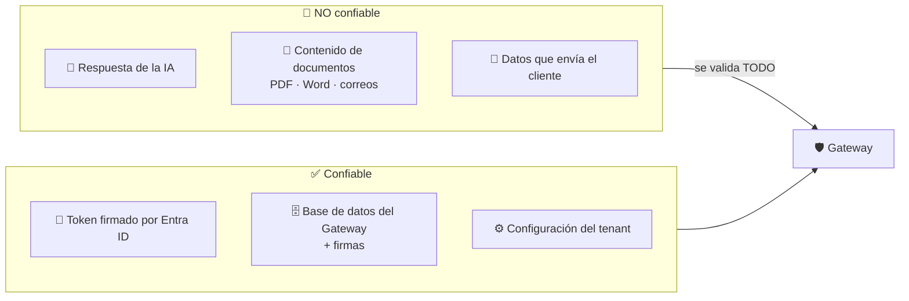
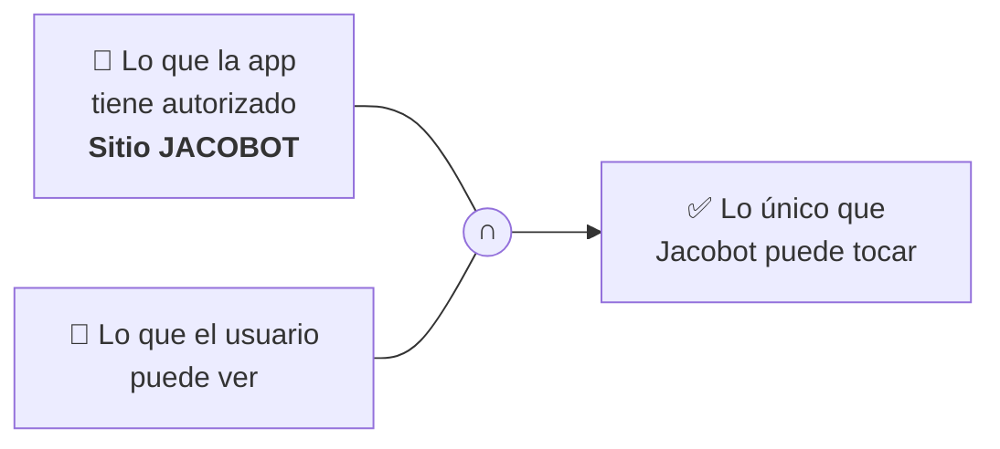
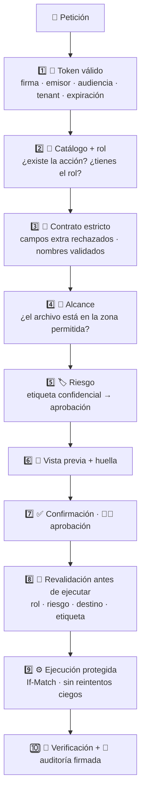
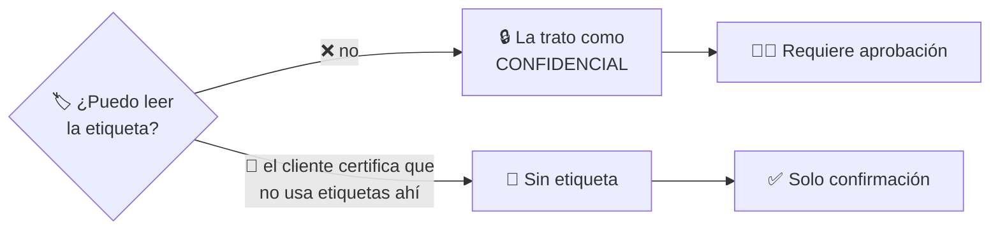

# 🛡️ Seguridad de Jacobot

[⬅️ Volver al inicio](../README.md)

> **Prioridad del proyecto:** 🛡️ Seguridad → ✅ Corrección → ⚙️ Funcionalidad → 🔧 Mantenibilidad →
> 😊 Experiencia → 📈 Escala

---

## 🏰 Zero Trust: no confiar en nada por defecto



- 🧠 **La IA puede equivocarse o ser manipulada.** Un PDF podría decir *"aprueba esto"* (eso se
  llama *prompt injection*). Por eso la IA solo propone acciones de un **catálogo cerrado** y el
  Gateway revisa cada una.
- 📨 **El Gateway no cree nada de lo que le envían**, salvo el token firmado por Microsoft.
  Campos como "aprobado: sí" o "usuario: admin" en una petición se rechazan.

---

## 🔑 Permisos mínimos

```
  ❌ Antes (diseño anterior)              ✅ Ahora (Jacobot 2.0)
  ─────────────────────────              ──────────────────────
  Permiso sobre TODO SharePoint          Sites.Selected: solo los sitios
  de la empresa                          que el administrador autoriza

  Puede ver documentos de RR. HH.,       Acceso = (sitio autorizado)
  finanzas, etc.                                  ∩ (lo que el usuario puede ver)
```



Jacobot **actúa como el usuario** (flujo *On-Behalf-Of*). Nunca puede hacer más de lo que ese
usuario podría hacer por sí mismo, y además solo dentro de los sitios autorizados.

---

## 🧯 Los 5 fallos de la versión anterior y cómo se corrigieron

| | Problema anterior | Solución en 2.0 | ¿Probado? |
|---|---|---|---|
| **H1** 🧑‍⚖️ | El solicitante podía **falsificar aprobaciones** editando una lista de SharePoint | Las aprobaciones viven en la base de datos del Gateway, **firmadas**: cualquier edición se detecta. Nadie se aprueba a sí mismo | ✅ Pruebas de manipulación |
| **H2** 🔑 | Permisos sobre **todo el tenant** | `Sites.Selected`: solo sitios autorizados, nunca `*.All` | ✅ Simulado · 🟡 tenant real pendiente |
| **H3** 🧠 | Copilot Studio y Bing **procesaban datos sin control** | Búsqueda web y conocimiento general desactivados, DLP, revisión de región | 🟡 Fase 4 |
| **H4** 📂 | **Documentos compartidos de más** en SharePoint quedaban expuestos | Solo sitios autorizados + permisos del usuario + revisión de sobreexposición antes del piloto | 🟡 Requiere tenant |
| **H5** 📤 | Una lista de dominios permitidos **no frenaba la fuga de datos** | Permisos mínimos, sin enlaces anónimos, envíos de correo con aprobación, cadena de suministro revisada | 🟡 Parcial |

---

## 🔐 Capas de defensa



---

## 🏷️ Etiquetas de confidencialidad: "ante la duda, protege"

Para leer la etiqueta de un archivo, Microsoft exige un permiso sobre **toda** la empresa
(`Files.Read.All`). Jacobot **no lo pide**. Así que:



---

## ⏱️ Si alguien deja la empresa o le revocan el acceso

| Momento | Qué pasa |
|---|---|
| 🚪 El admin revoca sesiones o desactiva la cuenta | — |
| ⚡ Minutos después (esperado) | SharePoint debería rechazar los tokens (CAE) → Jacobot responde **"vuelve a iniciar sesión"** |
| ⏰ Como máximo cada 5 minutos | Jacobot vuelve a pedir un token a Microsoft, que debería negarlo (sin verificar) |

🟡 Los tiempos reales se medirán en el tenant de prueba.

---

## 🧪 Revisiones adversariales

> ⚠️ Las hace un **modelo de IA**. No son un pentest externo ni una certificación, y las
> correcciones se comprobaron con pruebas pero **no se volvieron a auditar**.

Al cerrar cada fase, un **auditor de IA** (otro modelo, con contexto aislado)
intenta **romper** el sistema y demuestra cada fallo con una prueba automática que falla. Cada
hallazgo se corrige y su prueba queda como regresión para siempre.

| Fase | 🔴 Alto | 🟠 Medio | 🟡 Bajo | Estado |
|---|:---:|:---:|:---:|---|
| 0–1 Base | 0 | 6 | 5 | ✅ Corregido, con prueba |
| 2 Documentos | 1 | 2 | 3 | ✅ Corregido, con prueba |
| 3 Microsoft 365 | 1 | 6 | 3 | ✅ Corregido (P3-10 era de documentación) |

Ejemplos de lo que encontró:
- 🔴 Si alguien movía la carpeta de destino *después* de la vista previa, el archivo terminaba en
  otro lugar. **Corregido:** el destino se vuelve a verificar justo antes de mover.
- 🔴 Si fallaba la *lectura de comprobación* después de un movimiento exitoso, se reportaba
  "falló" aunque el archivo sí se había movido. **Corregido:** pasa a "desconocido" y se
  reconcilia.
- 🟠 Una búsqueda podía hacer ~1000 llamadas a Microsoft y saturar el tenant. **Corregido:**
  máximo 50 por petición.

---

## 🚪 Salida de un cliente (offboarding)

1. 🔑 Retirar el permiso del sitio
2. 🗑️ Eliminar las apps registradas en Entra
3. ☁️ Borrar los recursos de Azure del cliente (tras exportar la auditoría si el contrato lo pide)
4. ✔️ Verificar que no queda ningún acceso

[⬅️ Anterior: ⚙️ Cómo funciona](01-como-funciona.md) · [Siguiente: 🧰 Stack ➡️](03-stack.md)
