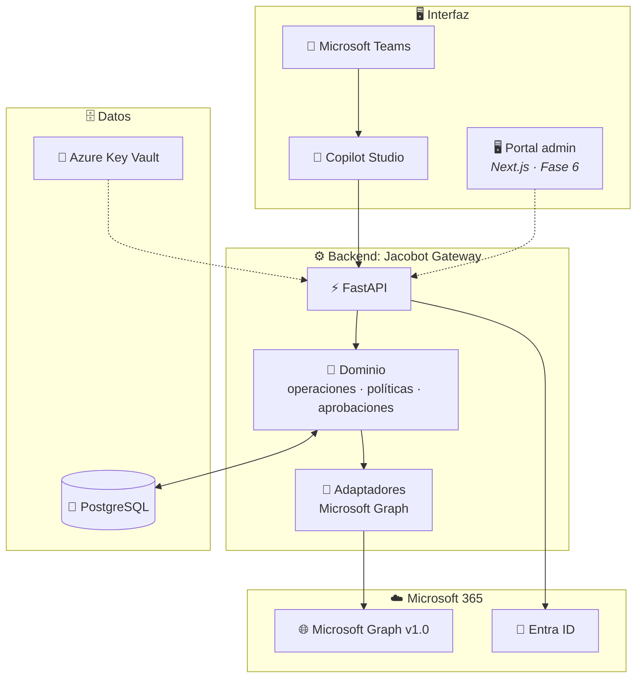
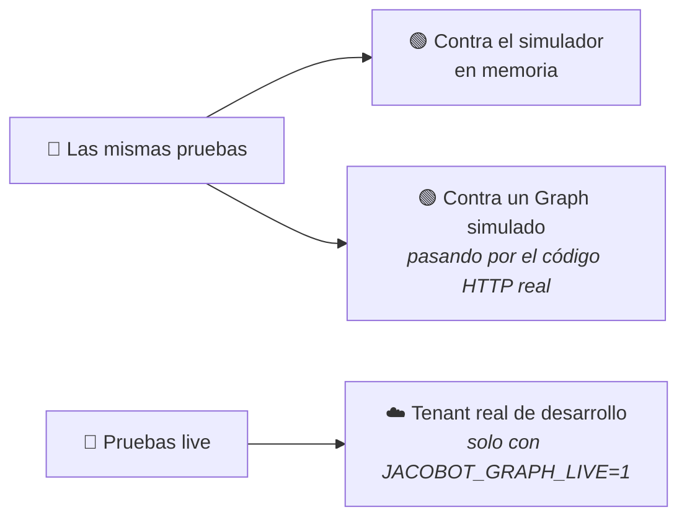

# 🧰 Stack tecnológico

[⬅️ Volver al inicio](../README.md)

---

## 🏗️ Vista general



---

## 📦 Tecnologías y por qué

| | Tecnología | Versión | ¿Para qué? |
|---|---|---|---|
| 🐍 | **Python** | 3.12 | Lenguaje del backend |
| ⚡ | **FastAPI** | 0.115 | API HTTP tipada y rápida |
| 🧾 | **Pydantic** | 2.14 | Contratos estrictos: rechaza datos que no esperamos |
| 🗄️ | **SQLAlchemy** | 2.0 | Acceso a base de datos |
| 🐘 | **PostgreSQL** | 17 | Base de datos de producción (las pruebas corren en SQLite y en PostgreSQL 17.12) |
| 🔁 | **Alembic** | 1.20 | Migraciones de la base de datos |
| 🔐 | **PyJWT** | 2.15 | Validación de tokens de Entra ID |
| 🎫 | **MSAL** | 1.39 | Intercambio de tokens On-Behalf-Of con Microsoft |
| 🌐 | **httpx** | 0.28 | Llamadas HTTP a Microsoft Graph |
| 🧪 | **pytest** | 9.2 | Pruebas automáticas |
| 🧹 | **ruff** | 0.17 | Estilo y errores comunes |
| 🔍 | **mypy** (estricto) | 2.4 | Verificación de tipos |
| 🐳 | **Docker** | — | Contenedores reproducibles (imagen construida y arrancada en local) |
| 🤖 | **GitHub Actions** | — | CI: lint, tipos, pruebas, migraciones, auditoría de dependencias (🟡 nunca ejecutada) |

Próximas fases: ⚛️ **Next.js + TypeScript + Tailwind** (portal) · 🔷 **Azure Container Apps,
Key Vault, Monitor, Bicep** (infraestructura).

---

## 🧱 Arquitectura: monolito modular

Una sola aplicación, bien separada por módulos. Para la primera versión es más fácil de operar y
mantener que muchos microservicios.

```
📦 jacobot (backend)
├── ⚡ api            → endpoints HTTP
├── 🚦 operations     → máquina de estados de operaciones
├── 🧩 actions        → lógica de cada acción (crear, archivar, renombrar)
├── 📖 reads          → consultas y búsqueda
├── 🧑‍⚖️ approvals      → aprobaciones firmadas
├── 📒 audit          → auditoría encadenada
├── 🔐 identity       → validación de tokens
├── 🎫 obo            → tokens On-Behalf-Of
├── 📜 policy         → catálogo de acciones, roles y riesgo
├── 🧾 contracts      → contratos de entrada y salida
├── 🔌 adapters       → interfaz de almacenamiento + simulador
├── 🌐 graph          → adaptador real de Microsoft Graph
├── 🔏 integrity      → huellas y firmas
├── 🗄️ db             → modelos de base de datos
└── ⚙️ config         → configuración por cliente
```

---

## 🧪 Cómo se prueba



| Nivel | Qué prueba | Estado |
|---|---|---|
| 🟢 **Simulador** | Lógica, seguridad, estados, resiliencia | ✅ Pasando |
| 🟢 **Graph simulado** | Todo lo anterior, pasando por el adaptador HTTP real | ✅ Pasando |
| 🟢 **Unitarias del adaptador** | Reintentos, paginación, errores, tokens | ✅ Pasando |
| 🔴 **Live** | Comportamiento real de Microsoft 365 | ⏳ Esperando el tenant |

📊 **205 pruebas distintas pasando** (305 ejecuciones en SQLite y 305 en PostgreSQL) · 5 pruebas
live a la espera del tenant.

### ✅ Control de calidad en cada cambio

```
🧹 ruff  →  🔍 mypy  →  🧪 pytest  →  🔁 migraciones  →  🛡️ auditoría  →  📝 docs
```

---

## 🤖 Cómo se construye

El proyecto se desarrolla con **Claude Code** (Anthropic), usando:
- 🧠 **Claude Opus**: implementación principal
- 🔎 **Claude Fable**: revisiones de seguridad en contexto aislado
- 🧩 **Skills propias**: `jacobot-security` y `jacobot-microsoft-graph`, con las reglas del proyecto
- 🕵️ **Subagente auditor**: `jacobot-security-auditor`, que intenta romper cada fase

[⬅️ Anterior: 🛡️ Seguridad](02-seguridad.md) · [Siguiente: 🗺️ Roadmap ➡️](04-roadmap.md)
