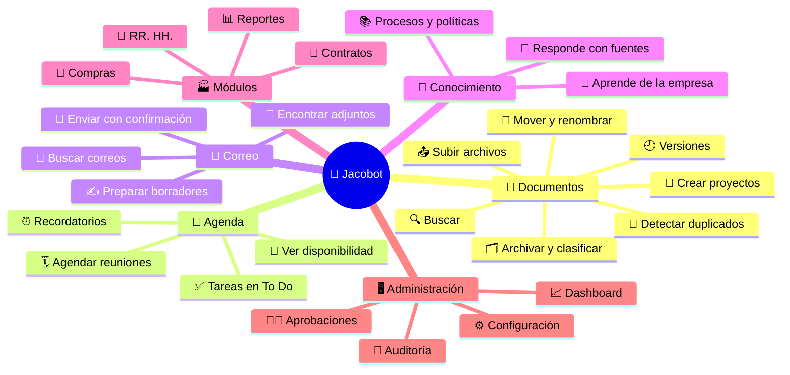
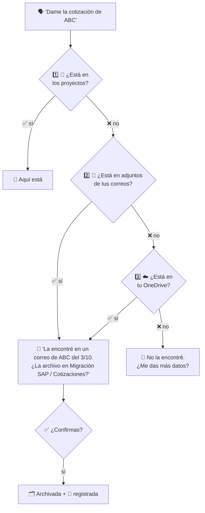
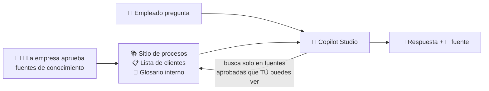

# 🗺️ Roadmap y visión

[⬅️ Volver al inicio](../README.md)

---

## 🌟 La visión: todo lo que hará Jacobot



---

## 🔍 "Si no la encuentras, búscala": búsqueda en cascada (próxima)

Cuando pides una cotización que no está en los proyectos, Jacobot sigue buscando en tus propias
fuentes, siempre con **tus** permisos:



🔒 Los pasos 2 y 3 usan permisos sobre **tu propio** correo y **tu propio** OneDrive, nunca sobre
los de toda la empresa.

---

## 🧠 "Aprende de la empresa": cómo funciona de verdad

> ⚠️ La IA **no memoriza** la información de la empresa ni la usa para entrenarse.



Antes de activarlo, hay que revisar que en SharePoint no haya documentos **compartidos de más**:
si un archivo confidencial está abierto a toda la empresa, la IA lo podría encontrar.

---

## 📅 Reuniones y recordatorios

```
 🗣️ "Agenda una reunión con compras el jueves para revisar la cotización ABC"
        │
        ▼
 📅 Jacobot revisa la disponibilidad de los participantes
        │
        ▼
 👀 Vista previa
    🗓️ Jueves 10:00 – 10:30
    👥 equipo de compras
    📎 Cotizacion_ABC_2026.pdf
    📍 Teams
        │
        ▼
 ✅ Tú confirmas  ──►  📨 se envía la invitación
```

⏰ **Recordatorios:** *"Recuérdame revisar el contrato el lunes"* → tarea en Microsoft To Do o
evento con aviso. Que Jacobot te escriba por iniciativa propia en Teams necesita un componente
extra (Power Automate o un bot de Teams).

🚫 **Jacobot nunca envía correos ni invitaciones sin tu confirmación.**

---

## 🛣️ Fases

| Fase | Qué incluye | Estado |
|---|---|---|
| 0 📐 | Investigación, arquitectura, modelo de amenazas, matriz de permisos | ✅ |
| 1 🧱 | Gateway, identidad, máquina de estados, aprobaciones, auditoría | ✅ |
| 2 🗂️ | Proyectos, archivar, mover, renombrar, buscar, registro documental | ✅ |
| 3 ☁️ | Adaptador de Microsoft Graph, On-Behalf-Of, guía de configuración del tenant | 🟡 Falta probar en un tenant real |
| 4 💬 | Teams, Copilot Studio, tarjetas de confirmación, DLP, conocimiento | ⏳ |
| 5 📅 | Outlook, calendario, recordatorios, búsqueda en cascada, contratos, compras, RR. HH., reportes | ⏳ |
| 6 🖥️ | Portal de administración (dashboard, aprobaciones, auditoría, configuración) | ⏳ |
| 7 🚀 | Infraestructura en Azure (Bicep), CI/CD, monitoreo, despliegue por cliente | ⏳ |
| 8 🧪 | Auditoría final, pruebas de carga y resiliencia, costos, piloto con una empresa | ⏳ |

### 🎯 ¿Cuándo está listo para un piloto?

- [x] ⚙️ El backend funciona
- [x] 🧾 Los contratos están validados
- [x] 📁 Crea proyectos y organiza documentos
- [x] 🔍 Busca solo en recursos autorizados
- [x] ✅ Las operaciones tienen confirmación
- [x] 📒 La auditoría registra las acciones
- [x] 🔁 Los reintentos son seguros
- [x] 🛡️ No quedan hallazgos ALTOS conocidos sin corregir
- [ ] 🔐 Autenticación probada en un tenant real
- [ ] 🔑 Permisos efectivos verificados en un tenant real
- [ ] 💬 Teams y Copilot Studio probados
- [ ] 🚀 Despliegue reproducible
- [ ] 📖 Documentación de instalación validada con un cliente
- [ ] 🚪 Procedimiento de retirada de permisos probado

---

## ⏭️ Próximo paso

```
 👤 Conseguir un tenant de prueba de Microsoft 365
      ├── 🆓 Sandbox de desarrollador (si calificas)
      └── 💳 Prueba de Business Basic (1 mes, ¡cancelar a tiempo!)
             │
             ▼
 ⚙️ Seguir la guía de configuración (app en Entra, sitio, permisos)
             │
             ▼
 🧪 Correr las pruebas live  ──►  🟢 Fase 3 cerrada  ──►  💬 Fase 4
```

[⬅️ Anterior: 🧰 Stack](03-stack.md) · [Siguiente: 📚 Glosario ➡️](05-glosario.md)
